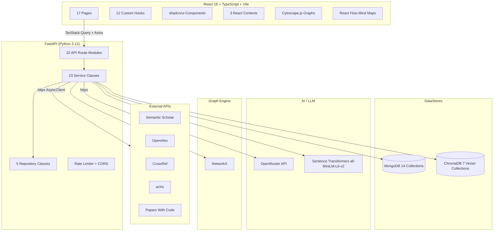
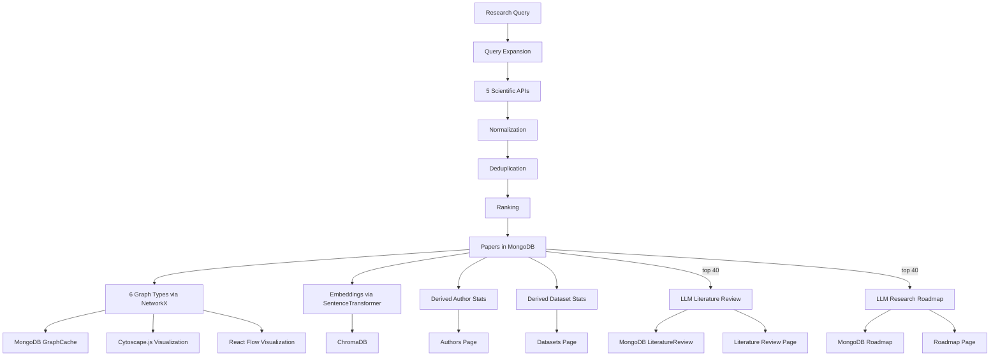

# ResearchOS -- Complete Architecture Document

> This document is a technical reverse-engineering of the ResearchOS codebase.
> Every claim is based on actual source-code inspection, not README marketing.

---

# 1. What Is ResearchOS?

## In Simple Engineering Terms

ResearchOS is a **web application** that lets a researcher enter a topic, then automatically searches five external scientific APIs, deduplicates the results, ranks them, stores them in a workspace, builds multiple graph visualizations using NetworkX, generates embeddings using Sentence Transformers into ChromaDB, and can produce AI-generated literature reviews and learning roadmaps via OpenRouter (LLM proxy).

## The Intended User

A graduate student, postdoc, or independent researcher who wants to rapidly survey a field.

## What the User Gives

- A natural-language research topic (e.g., "Vision Transformers for Fine-Grained Pest Classification")

## What the System Produces

- A ranked list of papers from 5 sources
- Multiple interactive graph visualizations (citation, knowledge, concept, author, dataset, topic)
- A research timeline
- An AI-generated literature review
- An AI-generated research roadmap
- A workspace that persists all of this

## ResearchOS in One Paragraph

ResearchOS is a React + FastAPI web application where a user enters a research topic, the backend searches Semantic Scholar, OpenAlex, CrossRef, arXiv, and Papers With Code concurrently using `asyncio.gather`, deduplicates results by DOI and fuzzy title matching, ranks them by a weighted scoring formula, stores them in MongoDB via Beanie ODM, builds six types of graphs with NetworkX, generates vector embeddings with Sentence Transformers into ChromaDB, and can produce AI-generated literature reviews and research roadmaps by calling OpenRouter's LLM API with the workspace's papers as context.

## High-Level Architecture Diagram



---

# 2. Complete Repository Structure

## Top Level

```
ResearchOs/
  backend/
    app/                    # Main Python package
    test_server.py          # Test file
    rebuild_concept_graph.py
    backfill_graphs.py
  frontend/
    src/                    # React source
    package.json
  README.md
```

## Backend Directory Structure

```
backend/app/
  main.py                     # FastAPI application entry point
  config.py                   # Pydantic Settings (env vars)
  api/                        # 22 API route modules
  services/                   # 23 business-logic service classes
  repositories/               # 5 data-access repositories
  models/                     # 14 Beanie ODM document models
  schemas/                    # Empty
  database/
    mongodb.py                # Motor + Beanie initialization
    chromadb.py               # ChromaDB PersistentClient + 7 collections
  middleware/
    rate_limit.py             # IP-based sliding-window rate limiter
  utils/
    logger.py                 # Loguru setup (stdout + rotating file)
  graph/                      # Empty
  embeddings/                 # Empty
  retrieval/                  # Empty
  ranking/                    # Empty
  analytics/                  # Empty
  ai/                         # Empty
  workspace/                  # Empty
  tests/                      # Empty
```

## Service Implementation Status

**REAL implementations** (doing actual work):

- `workspace_service.py` -- triggers discovery pipeline
- `discovery_service.py` -- orchestrates search, rank, graph
- `paper_service.py` -- 5 API integrations, deduplication
- `ranking_service.py` -- weighted scoring formula
- `graph_service.py` -- NetworkX graph construction
- `embedding_service.py` -- Sentence Transformers + ChromaDB
- `literature_service.py` -- OpenRouter LLM generation
- `roadmap_service.py` -- OpenRouter LLM generation
- `note_service.py` -- MongoDB CRUD
- `author_service.py` -- derives authors from papers
- `dataset_service.py` -- derives datasets from papers + PWC API
- `session_service.py` -- session tracking

**STUBBED** (hardcoded mock data, no real logic):

- `auth_service.py`, `assistant_service.py`, `analytics_service.py`, `timeline_service.py`, `search_service.py`, `hypothesis_service.py`, `export_service.py`, `bookmark_service.py`, `concept_service.py`, `compare_service.py`, `benchmark_service.py`, `institution_service.py`, `implementation_service.py`

### Empty Module Directories

The following directories contain only empty `__init__.py` files. All actual logic lives in `services/`:

- `graph/`, `embeddings/`, `retrieval/`, `ranking/`, `analytics/`, `ai/`, `workspace/`, `schemas/`, `tests/`

The README claims these as separate architectural modules. In reality, all logic is co-located in the `services/` layer.

---

# 3. Overall System Architecture

```
React 18 (Vite dev server, port 5173)
    |
    |  HTTP (axios baseURL="/api/v1")
    v
FastAPI (uvicorn, port 8000)
    |
    +-- CORSMiddleware (allows localhost:5173, localhost:3000)
    +-- RateLimitMiddleware (60 req/min per IP, in-memory dict)
    |
    v
22 API Route Modules
    |
    +-- Depends(get_xxx_service())  <-- new service instance per request
    |
    v
23 Service Classes
    |
    +-- Repository Layer (5 repos for MongoDB CRUD)
    |       |
    |       v
    |   MongoDB (Beanie ODM, Motor async driver)
    |
    +-- ChromaDB (PersistentClient, 7 collections)
    +-- NetworkX (in-memory graph computation, cached in MongoDB)
    +-- Sentence Transformers (all-MiniLM-L6-v2, CPU inference)
    +-- httpx AsyncClient --> Semantic Scholar, OpenAlex, CrossRef, arXiv, PWC
    +-- httpx AsyncClient --> OpenRouter (LLM, qwen-2-72b-instruct)
```

Key architectural facts:
1. Service instantiation per request via `Depends()`.
2. No dependency injection framework.
3. Repository pattern is partial -- only 5 of 23 services use repositories.
4. Graph computation is in-memory, results cached in MongoDB.
5. No background task queue -- `asyncio.ensure_future()` for fire-and-forget.
6. No WebSocket -- AI assistant is request-response, not streaming.

---

# 4. Frontend Architecture

## Entry Point

`frontend/src/main.tsx` wraps everything in `ThemeProvider > QueryClientProvider > BrowserRouter > App`.

TanStack Query configured with 5-minute staleTime, 1 retry, no refetch on window focus.

## Routing

`frontend/src/App.tsx`:

| Path | Page |
|------|------|
| `/` | LandingPage |
| `/app` | DashboardLayout > DashboardPage |
| `/app/discovery` | DiscoveryPage |
| `/app/knowledge-graph` | KnowledgeGraphPage |
| `/app/mind-maps` | MindMapPage |
| `/app/timeline` | TimelinePage |
| `/app/papers` | PapersPage |
| `/app/literature-review` | LiteratureReviewPage |
| `/app/research-gaps` | ResearchGapsPage |
| `/app/datasets` | DatasetsPage |
| `/app/authors` | AuthorsPage |
| `/app/roadmap` | RoadmapPage |
| `/app/analytics` | AnalyticsPage |
| `/app/bookmarks` | BookmarksPage |
| `/app/notes` | NotesPage |
| `/app/settings` | SettingsPage |
| `/app/workspace/:id` | WorkspacePage |
| `/app/new-workspace` | NewWorkspacePage |

## Layout

`DashboardLayout` renders: `Sidebar | TopNav + <Outlet/> + RightPanel`

- Sidebar: Navigation links
- TopNav: Top bar
- RightPanel: AI assistant chat panel
- Outlet: Current page with Framer Motion transitions

## State Management

**React Context** (NOT Zustand -- Zustand is in package.json but unused):

| Context | Purpose | Persistence |
|---------|---------|-------------|
| WorkspaceContext | Current workspace, list, loading | localStorage |
| ThemeContext | Dark/light theme toggle | localStorage |
| SidebarContext | Sidebar open/close | In-memory |

## API Client

`frontend/src/lib/api.ts`: Axios instance with `baseURL: "/api/v1"`. Exports `apiGet`, `apiPost`, `apiPatch`, `apiDelete`.

## Custom Hooks

| Hook | API Endpoint | Type |
|------|-------------|------|
| useWorkspace | GET/POST/PATCH/DELETE /workspaces | Query+Mutation |
| useDiscovery | POST /discovery/search | Mutation |
| usePaperSearch | GET /papers | Query |
| useGraph | GET /graph/{id}/{type} | Query |
| useTimeline | GET /timeline/{id} | Query |
| useLiteratureReview | GET/POST /review/{id} | Query+Mutation |
| useRoadmap | GET/POST /roadmap/{id} | Query+Mutation |
| useAnalytics | GET /analytics/{id} | Query |
| useAssistant | POST /assistant/chat | Mutation+useState |
| useNotes | CRUD /notes | Query+Mutation |
| useBookmarks | GET/POST/DELETE /bookmarks | Query+Mutation |
| useAuthors | GET /authors | Query |
| useDatasets | GET /datasets | Query |
| useSearch | GET /search, /suggestions | Query (debounced) |

## Graph Visualization

**KnowledgeGraphPage** (Cytoscape.js):
- Fetches graph data via `useGraph(workspaceId, graphType)`
- 6 graph types: citation, knowledge, concept, author, dataset, topic
- COSE layout, node colors by type, click-to-select, zoom controls

**MindMapPage** (React Flow):
- Fetches concept graph data
- d3-force layout (300 ticks simulation)
- PNG export via html-to-image, fullscreen mode

## Request Flow Example

```
User clicks "Create workspace"
  -> NewWorkspacePage.handleSubmit()
  -> useCreateWorkspace().mutateAsync()
  -> apiPost("/workspaces", data)
  -> Axios POST /api/v1/workspaces
  -> FastAPI: workspaces.create_workspace()
  -> WorkspaceService: creates workspace, fires background discovery
  -> Returns workspace JSON
  -> navigate("/app/workspace/{id}")
```

---

# 5. Backend / FastAPI Architecture

## Startup

`main.py` uses `lifespan` context manager:
1. `init_mongodb()`: Motor client + Beanie init with 14 document models
2. `init_chromadb()`: PersistentClient + 7 collections
3. On shutdown: close both connections

## Middleware

1. **CORSMiddleware**: Origins `localhost:5173`, `localhost:3000`
2. **RateLimitMiddleware**: IP-based sliding window, 60 req/min, in-memory `defaultdict(list)`

## Request Lifecycle

```
HTTP Request
  -> RateLimitMiddleware.dispatch() -- checks IP count in last 60s
  -> CORSMiddleware -- preflight, headers
  -> FastAPI router matching (by prefix)
  -> Endpoint function
  -> Depends(get_xxx_service()) -- new service instance
  -> Service method
  -> Repository / ChromaDB / NetworkX / httpx (external API / LLM)
  -> Response dict wrapped in {status, message, data}
  -> HTTP JSON Response
```

## Authentication

**NOT implemented.** `AuthService` returns hardcoded mock data. No JWT tokens created or validated. No protected routes. All endpoints accept any request.

---

# 6. API Architecture

## All 22 Route Modules

| Prefix | Module | Endpoints |
|--------|--------|-----------|
| /api/v1/auth | auth.py | POST /login, POST /register, GET /me, POST /guest |
| /api/v1/workspaces | workspaces.py | POST /, GET /, GET/{id}, PATCH/{id}, DELETE/{id}, POST/{id}/sync, GET/{id}/progress |
| /api/v1/papers | papers.py | GET /, GET /search, GET/{id}, POST /, DELETE/{id}, GET/{id}/similar |
| /api/v1/authors | authors.py | GET /, GET/{id}, GET/{id}/papers, GET/{id}/coauthors |
| /api/v1/datasets | datasets.py | GET /, GET/{id}, GET/{id}/papers, GET/{id}/leaderboard |
| /api/v1/graph | graph.py | GET/{wid}/citation, /knowledge, /concept, /author, /dataset, /topic, POST/{wid}/regenerate |
| /api/v1/timeline | timeline.py | GET/{wid}, POST/{wid}/regenerate, GET/{wid}/play |
| /api/v1/review | review.py | GET/{wid}, POST/{wid}/generate, GET/{wid}/export |
| /api/v1/roadmap | roadmap.py | GET/{wid}, POST/{wid}/generate |
| /api/v1/assistant | assistant.py | POST /chat, POST /summarize, POST /compare, POST /explain, GET/{wid}/history |
| /api/v1/analytics | analytics.py | GET/{wid}, GET/{wid}/trends, GET/{wid}/distributions |
| /api/v1/discovery | discovery.py | POST /search, POST /expand, GET /trending |
| /api/v1/concepts | concepts.py | GET /, GET/{id}, GET/{id}/evolution, GET/{id}/papers, GET/{id}/family-tree |
| /api/v1/implementations | implementations.py | GET /search, GET/{id}, GET/{id}/models |
| /api/v1/benchmarks | benchmark.py | GET /, GET/{id}, GET/{id}/leaderboard |
| /api/v1/institutions | institutions.py | GET /, GET/{id}, GET/{id}/researchers |
| /api/v1/hypothesis | hypothesis.py | POST /test, POST /generate, POST /novelty |
| /api/v1/sessions | sessions.py | GET/{wid}, POST/{wid}, GET/{wid}/{sid} |
| /api/v1/search | search.py | GET /, GET /suggestions, GET /history |
| /api/v1/bookmarks | bookmarks.py | GET /, POST /, DELETE/{id} |
| /api/v1/notes | notes.py | GET/{wid}, POST /, GET/{wid}/{nid}, PATCH/{wid}/{nid}, DELETE/{wid}/{nid} |
| /api/v1/export | export.py | POST /workspace/{wid}, POST /review/{wid}, POST /graph/{wid} |
| /api/v1/compare | compare.py | POST /papers, POST /methods, POST /datasets |

---

# 7. The Central Workspace Concept

## Workspace Model

```python
class Workspace(Document):
    user_id: str
    title: str
    topic: str
    status: str          # "creating" | "creating:15" | "ready"
    statistics: dict     # {papers, authors, datasets, methods, citations}
    graph_ids: list[str] # Currently unused
    timeline_id: str     # Currently unused
    literature_review_id: str  # Currently unused
    roadmap_id: str      # Currently unused
    search_history: list[dict]
    settings: dict
```

## How a Workspace Is Created

1. User enters topic in `NewWorkspacePage`
2. `POST /api/v1/workspaces` with `{user_id, topic, title}`
3. `WorkspaceService.create_workspace()`:
   - Creates workspace in MongoDB with `status: "creating"`
   - Fires `asyncio.ensure_future(discovery_service.discover_topic(topic, workspace_id))` in background
   - Returns workspace immediately
4. Background discovery updates `status` through stages: `query_expansion:5` -> `search:15` -> `dedup:40` -> `ranking:55` -> `embedding:70` -> `graph:85` -> `complete:100` -> `ready`

## Data Relationships

- **Papers**: `Paper.workspace_id == workspace_id` (string FK)
- **Graphs**: `GraphCache.workspace_id == workspace_id` (6 types)
- **Reviews**: `LiteratureReview.workspace_id == workspace_id`
- **Roadmaps**: `Roadmap.workspace_id == workspace_id`
- **Notes**: `Note.workspace_id == workspace_id`
- **Sessions**: `Session.workspace_id == workspace_id`
- **Bookmarks**: `Bookmark.user_id` (NOT workspace-scoped)

All relationships are string-based foreign keys, not Beanie `Link` references. No referential integrity at DB level.

---

# 8. Research Discovery Pipeline

This is the most important real implementation.

```
User enters topic
  |
  v
WorkspaceService.create_workspace()
  -> creates workspace, fires background task
  |
  v
DiscoveryService.discover_topic(topic, workspace_id)
  |
  +-- Stage 1: Query Expansion (5%)
  |   expand_query(topic) -- splits words, generates plurals/gerunds/lowercase
  |   Returns first 5 expanded terms
  |
  +-- Stage 2: Search (15%)
  |   For each of 5 expanded queries (SEQUENTIAL):
  |     PaperService.search_all_sources(query)
  |       -> asyncio.gather(5 APIs CONCURRENTLY)
  |       -> Semantic Scholar, OpenAlex, CrossRef, arXiv, Papers With Code
  |
  +-- Stage 3: Deduplication (40%)
  |   merge_results() -- DOI-based dedup
  |   deduplicate() -- DOI + SequenceMatcher ratio > 0.85
  |
  +-- Stage 4: Ranking (55%)
  |   RankingService.rank_papers() -- weighted scoring formula
  |
  +-- Stage 5: Embeddings (70%)
  |   Top 50 papers: encode title + abstract
  |
  +-- Stage 6: Graph Construction (85%)
  |   6 graph types built with NetworkX, cached in MongoDB
  |
  +-- Stage 7: Save and Complete (100%)
      Bulk insert papers, set workspace status to "ready"
```

**Concurrency detail**: 5 expanded queries processed sequentially, each querying 5 APIs concurrently = up to 25 HTTP requests total, but only 5 in parallel at any time.

---

# 9. Query Expansion

Rule-based morphological expansion (NOT LLM-based):

```python
async def expand_query(self, query: str) -> list[str]:
    terms = query.strip().split()
    expanded = set(terms)
    for term in terms:
        if len(term) > 3:
            expanded.add(f"{term}s")      # plural
            expanded.add(f"{term}ing")    # gerund
            expanded.add(f"{term}es")     # -es form
        expanded.add(term.lower())
        expanded.add(term.upper())
    return list(expanded)
```

---

# 10. Paper Normalization and Deduplication

## Normalization

All 5 API responses normalized to:
```python
{
    "title": str, "abstract": str|None, "year": int|None,
    "venue": str|None, "citation_count": int, "doi": str|None,
    "paper_url": str|None, "authors": [{"name": str, "id": str}],
    "paper_source": "semantic_scholar"|"openalex"|"crossref"|"arxiv"|"papers_with_code"
}
```

Source-specific:
- OpenAlex: Reconstructs abstract from `abstract_inverted_index`
- CrossRef: Year from `published-print`/`published-online` date-parts
- arXiv: XML (Atom format), parsed with `xml.etree.ElementTree`
- Papers With Code: No abstract (always None), provides `implementation_links`

## Deduplication (Two-pass)

1. `merge_results()`: DOI-based dedup using `seen` set
2. `deduplicate()`: DOI exact match + `SequenceMatcher.ratio() > 0.85` on lowercase titles

No author-based dedup. No title normalization beyond `.lower().strip()`.

---

# 11. Paper Ranking Engine

```python
score = (
    semantic_similarity * 0.3       # Default 0.5 (never computed)
    + citation_count / 1000 * 0.2   # Normalized, capped at 1.0
    + recency * 0.15                # Linear decay from 2000 to current year
    + venue_quality * 0.1           # Default 0.5 (never set)
    + author_influence * 0.1        # Default 0.5 (never set)
    + implementation_availability * 0.15  # 1.0 if has code links
)
```

**Critical limitation**: `semantic_similarity` is always 0.5 because topic embedding is never computed. `venue_quality` and `author_influence` also default to 0.5.

---

# 12. Knowledge Graph Architecture

## 6 Graph Types

| Type | Nodes | Edges | Directed |
|------|-------|-------|----------|
| Knowledge | papers, authors, datasets, methods | authored, uses_dataset, uses_method | No (Graph) |
| Citation | papers | cites, cited_by | Yes (DiGraph) |
| Concept | papers, keywords/methods/datasets | discusses | No (Graph) |
| Author | authors | collaborates | No (Graph) |
| Dataset | datasets, papers | uses | No (Graph) |
| Topic | topics, papers | related_to, belongs_to | No (Graph) |

## Serialization

`_graph_to_dict()` converts NetworkX to `{"nodes": [...], "edges": [...], "node_count": int, "edge_count": int}`.

## Caching

Graphs cached in `GraphCache` MongoDB collection per `(workspace_id, graph_type)`. Updated if exists, inserted if not.

---

# 13. Graph Visualization

**KnowledgeGraphPage** (Cytoscape.js): COSE layout, node colors by type, click-to-select, zoom. Search input exists but is non-functional.

**MindMapPage** (React Flow): d3-force layout (300 ticks), concept/paper coloring, hover tooltips, PNG export, fullscreen.

---

# 14. Research Timeline

**STUBBED.** `TimelineService.get_timeline()` returns 6 hardcoded ViT-related events. `TimelineCache` model exists but is never used. No real timeline computation.

---

# 15. Embedding Pipeline

```
Paper title/abstract
  -> SentenceTransformer("all-MiniLM-L6-v2")
  -> 384-dimensional vector
  -> ChromaDB collection.add()
```

7 ChromaDB collections created. Only `paper_embeddings` written to during discovery. **Bug**: `generate_paper_embeddings()` returns embeddings but they are not passed to `store_embedding()` -- embeddings are computed but discarded.

---

# 16. Retrieval / RAG Pipeline

**NOT IMPLEMENTED.** `backend/app/retrieval/` is an empty `__init__.py`. No vector search retrieval, no context assembly. AI features use raw MongoDB paper data as context, not vector-retrieved relevant papers. ChromaDB embeddings generated during discovery are never queried.

---

# 17. AI Architecture

## LLM Integration

- **Provider**: OpenRouter (`https://openrouter.ai/api/v1`)
- **Model**: `qwen-2-72b-instruct` (configurable)
- **Client**: Raw `httpx.AsyncClient` (NOT OpenAI SDK)
- **Timeout**: 120 seconds

## Where LLM Is Actually Used

1. **Literature Review**: Top 40 papers from MongoDB -> system prompt -> OpenRouter -> JSON sections -> MongoDB
2. **Roadmap**: Workspace topic + top 40 papers -> system prompt -> OpenRouter -> JSON steps -> MongoDB

## Where LLM Is NOT Used (Stubbed)

- AI Assistant chat: Returns hardcoded response, no LLM call
- Paper summarization: Returns hardcoded string
- Paper comparison: Returns hardcoded string
- Concept explanation: Returns hardcoded string

No evidence chains, confidence scoring, citation grounding, streaming, token counting, or retry logic for LLM calls.

---

# 18. Literature Review Generation

```
POST /api/v1/review/{workspace_id}/generate
  -> Paper.find(workspace_id).sort("-citation_count").limit(40)
  -> Format: "[1] Title: ...\nYear: ...\nAbstract: ...\n" * 40
  -> System prompt: "You are an expert AI research scientist..."
  -> httpx POST to OpenRouter /chat/completions
  -> Parse JSON response (handles code blocks)
  -> Upsert into literature_reviews collection
```

Sections include title, content, citations (paper title strings -- NOT validated). Export to Markdown is client-side. PDF export is simulated (downloads markdown).

---

# 19. Research Gap Detection

**NOT IMPLEMENTED.** `ResearchGapsPage.tsx` shows placeholder text. No API endpoint exists. `research_gap_id` on Workspace is never set.

---

# 20. Research Roadmap

```
POST /api/v1/roadmap/{workspace_id}/generate
  -> Workspace.get(wid) -> topic
  -> Paper.find(wid).sort("-citation_count").limit(40)
  -> System prompt requesting JSON with "steps"
  -> httpx -> OpenRouter
  -> Parse JSON, store in Roadmap collection
```

Steps include day, title, description, duration_hours, papers (titles), resources. Progress tracking shows hardcoded 0%.

---

# 21. Research Analytics

**STUBBED.** Returns hardcoded values (`total_papers: 1247`, etc.) and formulaically generated trends. Recharts is in package.json but not used in AnalyticsPage -- uses inline `<Progress>` components instead.

---

# 22. Notes and Bookmarks

**Notes** (fully implemented): Markdown content stored in MongoDB, tag-based organization, CRUD operations.

**Bookmarks** (stubbed): Model exists, service returns hardcoded mock data.

---

# 23. Database Architecture

## MongoDB (14 Collections)

| Collection | Purpose | Indexes |
|------------|---------|---------|
| users | User accounts | email, (auth_provider, auth_id) |
| workspaces | Research workspaces | user_id, status, (user_id, updated_at) |
| papers | Research papers | workspace_id, (workspace_id, title), doi, keywords, year |
| authors | Author profiles | name, orcid, topics, h_index |
| datasets | Research datasets | name, task |
| methods | Research methods | name, category |
| concepts | Research concepts | name, category |
| sessions | Research sessions | workspace_id, (workspace_id, session_number) |
| notes | Markdown notes | workspace_id, (workspace_id, paper_id), tags |
| bookmarks | User bookmarks | user_id, (user_id, entity_type, entity_id) |
| graph_caches | Cached graph data | workspace_id, (workspace_id, graph_type) |
| timeline_caches | Cached timelines | workspace_id |
| literature_reviews | Generated reviews | workspace_id |
| roadmaps | Generated roadmaps | workspace_id |

## ChromaDB (7 Collections)

| Collection | Actually Populated |
|------------|-------------------|
| paper_embeddings | Written but likely discarded (bug) |
| abstract_embeddings | No |
| summary_embeddings | No |
| author_embeddings | No |
| topic_embeddings | No |
| dataset_embeddings | No |
| concept_embeddings | No |

**Roles**: MongoDB = all structured application data. ChromaDB = vector search data (currently not effectively used).

---

# 24. External Scientific APIs

All 5 use `httpx.AsyncClient(timeout=30)` with identical Tenacity retry: 3 attempts, exponential backoff (1s-10s), retries on TimeoutException and HTTPStatusError only.

| API | Base URL | Auth | Notes |
|-----|----------|------|-------|
| Semantic Scholar | api.semanticscholar.org/graph/v1 | Optional x-api-key | Also used for paper details |
| OpenAlex | api.openalex.org | None | Abstract from inverted index |
| CrossRef | api.crossref.org/works | None | No abstract |
| arXiv | export.arxiv.org/api/query | None | XML/Atom format, no citations |
| Papers With Code | paperswithcode.com/api/v1 | None | Provides code links |

---

# 25. Authentication and Security

**Authentication**: NOT implemented. Hardcoded mock responses.

**Security that exists**:
- Rate limiting (60/min/IP, in-memory)
- CORS (localhost:5173, localhost:3000)
- Pydantic validation on request bodies

**Security that does NOT exist**:
- JWT tokens, password hashing, protected routes, user/workspace authorization, CSRF protection

---

# 26. Async / Concurrency

- 5 external API calls per query run via `asyncio.gather()` (concurrent)
- 5 expanded queries run sequentially (each with 5 concurrent calls)
- Background tasks via `asyncio.ensure_future()` (no persistence, no retry, lost on restart)
- No connection pooling for external APIs
- No proper task queue

---

# 27. Complete End-to-End Flows

### Flow 1: Create Workspace
```
NewWorkspacePage -> useCreateWorkspace -> apiPost("/workspaces")
  -> WorkspaceService.create_workspace -> MongoDB insert + asyncio.ensure_future(discovery)
  -> Returns workspace -> navigate("/app/workspace/{id}")
```

### Flow 2: Discovery Search
```
DiscoveryPage -> useDiscoverySearch -> apiPost("/discovery/search")
  -> DiscoveryService.discover_topic -> full pipeline -> returns papers
```

### Flow 3: View Knowledge Graph
```
KnowledgeGraphPage -> useGraph -> apiGet("/graph/{wid}/knowledge")
  -> GraphService.get_cached_graph -> MongoDB GraphCache -> Cytoscape.js
```

### Flow 4: Generate Literature Review
```
LiteratureReviewPage -> useGenerateReview -> apiPost("/review/{wid}/generate")
  -> LiteratureService -> Paper.find (top 40) -> httpx OpenRouter -> JSON -> MongoDB
```

### Flow 5: Generate Roadmap
```
RoadmapPage -> useGenerateRoadmap -> apiPost("/roadmap/{wid}/generate")
  -> RoadmapService -> Workspace.get + Paper.find (top 40) -> httpx OpenRouter -> JSON -> MongoDB
```

### Flow 6: AI Assistant
```
RightPanel -> useAssistant -> apiPost("/assistant/chat")
  -> AssistantService.chat() -> returns hardcoded mock (NO LLM call)
```

---

# 28. Architectural Decisions

| Technology | Problem | Where Used | Tradeoffs |
|-----------|---------|------------|-----------|
| React 18 | Interactive SPA | Frontend | CSR only, no SSR |
| FastAPI | Async Python HTTP | Backend | Python GIL, but async I/O fits |
| MongoDB + Beanie | Flexible documents | Primary DB | No referential integrity |
| ChromaDB | Vector search | Embeddings | Single-node, retrieval not implemented |
| NetworkX | Graph computation | 6 graph types | In-memory, recomputed per request |
| Cytoscape.js | Graph visualization | KnowledgeGraphPage | Large bundle |
| React Flow | Mind map visualization | MindMapPage | Different paradigm than Cytoscape |
| Sentence Transformers | Embeddings | Embedding generation | CPU-only, 384-dim |
| OpenRouter | LLM access | Reviews + Roadmaps | External dependency, cost |
| TanStack Query | Server state | All API calls | Learning curve |
| Zustand | Client state | NOT USED | In package.json but never imported |
| AsyncIO | Concurrent I/O | External API calls | Complexity, no persistence |
| Tenacity | Retry logic | 5 scientific APIs | Adds latency on retries |

---

# 29. Scalability Analysis

## Current Bottlenecks

| Component | Issue | Scale Impact |
|-----------|-------|-------------|
| Discovery Pipeline | 25 HTTP requests per topic | Linear with users |
| Graph Construction | NetworkX in-memory, recomputed | CPU-bound for large graphs |
| Embedding Generation | CPU-only SentenceTransformer | Slow for many papers |
| ChromaDB | Single-node embedded | Cannot scale horizontally |
| LLM Calls | External API, 120s timeout | Cost-proportional |
| Background Tasks | asyncio.ensure_future | Lost on restart |
| Rate Limiting | In-memory per-IP dict | Not distributed |

## Scaling Path

10 researchers: Works fine.

1,000 researchers: Need MongoDB Atlas, Redis caching, proper task queue.

100,000 researchers: Need Celery/Redis, ChromaDB -> Pinecone/Weaviate, horizontal FastAPI scaling, MongoDB sharding, LLM request queuing, CDN.

---

# 30. Failure Modes

| Failure | Impact | Mitigation |
|---------|--------|-----------|
| MongoDB down | All data ops fail | Server won't start |
| ChromaDB down | Embedding ops fail | Server won't start |
| Any scientific API fails | Empty results from that source | `except Exception: return []` |
| OpenRouter fails | Review/roadmap returns error section | Fallback with error message |
| LLM timeout | 120s wait, error section returned | httpx timeout |
| Rate limit hit | 429 response | Client-side retry needed |
| Embedding generation fails | Papers saved without embeddings | Logged, continues |
| Graph construction fails | Empty graph cached | Logged, empty nodes/edges |
| Background task fails | Workspace stuck in "creating" | No automatic retry |

---

# 31. Performance

- External API calls: 5 concurrent per query, 30s timeout each
- Graph computation: O(V+E) per graph type, 6 graphs built sequentially
- Embedding generation: ~50 papers * 2 texts each, CPU-bound
- LLM calls: 120s timeout, blocking (not parallelized with other work)
- No caching beyond GraphCache and ChromaDB
- No pagination on most queries
- MongoDB indexes exist on workspace_id, doi, year, keywords

---

# 32. Data Flow Diagram



---

# 33. Interview Defense

## "Walk me through ResearchOS."

ResearchOS is a full-stack web app where a researcher enters a topic. The FastAPI backend searches 5 scientific APIs concurrently, deduplicates by DOI and title similarity, ranks by a weighted formula, stores papers in MongoDB, builds 6 graph types with NetworkX, and generates embeddings into ChromaDB. The React frontend renders all of this with Cytoscape.js for graphs and React Flow for mind maps. AI features call OpenRouter for literature review and roadmap generation.

## "What happens when I search for a research topic?"

The query expands into morphological variants. The first 5 variants each search Semantic Scholar, OpenAlex, CrossRef, arXiv, and Papers With Code concurrently via `asyncio.gather()`. Results are normalized to a common schema, deduplicated by DOI and fuzzy title matching (SequenceMatcher > 0.85), ranked by a weighted scoring formula, and stored in MongoDB. The top 50 get embeddings generated. Six graph types are built with NetworkX and cached.

## "How do you deduplicate papers?"

Two-pass: first pass deduplicates by DOI using a set. Second pass uses `difflib.SequenceMatcher` to compare lowercase titles, deduplicating if the ratio exceeds 0.85.

## "How does your knowledge graph work?"

NetworkX constructs in-memory graphs from paper metadata. For the knowledge graph, papers connect to authors (authored), datasets (uses_dataset), and methods (uses_method). Results are serialized to `{nodes, edges}` and cached in MongoDB's `graph_caches` collection. The frontend renders with Cytoscape.js using the COSE layout.

## "Why NetworkX?"

It is Python-native, requires no external service, provides rich graph algorithms, and serializes easily. The tradeoff is it is in-memory and recomputed each time -- acceptable for the current scale.

## "How does your RAG pipeline work?"

It does not. The retrieval directory is empty. AI features use raw paper data from MongoDB as context, not vector-retrieved relevant papers. ChromaDB is set up but the retrieval pipeline is not implemented.

## "How does the AI assistant know about the workspace?"

It does not. The assistant service returns hardcoded mock responses. No actual LLM call is made.

## "How are literature reviews generated?"

Top 40 papers by citation count are fetched from MongoDB, formatted as a numbered context string, and sent to OpenRouter's LLM with a system prompt requesting structured JSON sections. The response is parsed and stored in the `literature_reviews` collection.

## "How would you scale ResearchOS?"

Replace `asyncio.ensure_future` with Celery/Redis task queue. Replace ChromaDB with a distributed vector DB like Pinecone. Add Redis caching for graphs. Horizontal scale FastAPI behind a load balancer. Add LLM request queuing with budget management.

## "What happens when an external API fails?"

Each API call is wrapped in try/except that returns `[]` on failure. The pipeline continues with results from the remaining sources. Tenacity retries up to 3 times with exponential backoff for timeout and HTTP errors.

## "What is the biggest bottleneck?"

The discovery pipeline: 25 HTTP requests per topic, processed in 5 sequential rounds of 5 concurrent calls. For many concurrent users, external API rate limits (especially Semantic Scholar's 100 req/5min without key) become the constraint.

## "What would you redesign?"

1. Implement the RAG pipeline for the AI assistant
2. Replace stubbed services with real implementations
3. Add a proper background task queue
4. Implement actual authentication
5. Use the ChromaDB embeddings that are generated but discarded

---

# 34. ResearchOS Mental Model

## Level 1 -- 10 seconds

ResearchOS is a research workspace where you type a topic and get papers, graphs, reviews, and roadmaps automatically.

## Level 2 -- 30 seconds

A React frontend talks to a FastAPI backend. The backend searches 5 scientific APIs, stores papers in MongoDB, builds graphs with NetworkX, generates embeddings with Sentence Transformers into ChromaDB, and calls OpenRouter for AI-generated literature reviews and roadmaps.

## Level 3 -- 2 minutes

The user enters a topic, which creates a workspace. A background discovery pipeline expands the query, searches 5 APIs concurrently, deduplicates, ranks, stores papers, builds 6 graph types, and generates embeddings. The frontend shows the workspace with papers, graphs (Cytoscape.js), mind maps (React Flow), timeline, analytics, notes. AI features generate literature reviews and roadmaps by sending the top 40 papers to OpenRouter's LLM.

## Level 4 -- 5 minutes

The pipeline starts with workspace creation, which fires an async background task. Query expansion produces morphological variants. Five expanded queries each hit 5 APIs concurrently (25 total requests). Results normalize to a common schema. Deduplication uses DOI exact matching and title fuzzy matching (SequenceMatcher > 0.85). Ranking uses a weighted formula with citation count, recency, and implementation availability as the effective features (semantic similarity and venue quality default to 0.5). Top 50 papers get embeddings via SentenceTransformer but these are computed and discarded (bug). Six graph types are built with NetworkX and cached in MongoDB. The workspace status updates through progress stages. The frontend polls this status. AI features send the top 40 papers to OpenRouter as context for literature review and roadmap generation.

## Level 5 -- Deep Dive

**Discovery**: `asyncio.ensure_future()` fires the pipeline. Five sequential rounds of `asyncio.gather()` for 5 concurrent API calls each. Each API response normalized by source-specific parsers (OpenAlex inverted index reconstruction, arXiv XML parsing, CrossRef date-parts extraction). Two-pass deduplication. Ranking by formula with mostly default values.

**Storage**: MongoDB via Beanie ODM with 14 document models. String-based foreign keys. ChromaDB with 7 collections (only 1 written to, but not queried).

**Graphs**: NetworkX builds 6 graph types in-memory. Knowledge graph connects papers to authors/datasets/methods. Citation graph is directed. All serialized to `{nodes, edges}` and cached in `graph_caches`.

**AI**: OpenRouter API via raw httpx. Literature review and roadmap generation are the only real LLM integrations. System prompts request JSON output. 120s timeout. Error fallback returns error section.

**Frontend**: React 18 + TanStack Query for server state. React Context for client state (NOT Zustand). Cytoscape.js for graph visualization with COSE layout. React Flow for mind maps with d3-force layout. 12 custom hooks wrap all API interactions.

---

# Verified Architecture Notes

## Confirmed from Source Code

- 22 API route modules (not 23 as README claims -- difference may be counting root router)
- 23 service classes (not 10 as README claims)
- 5 repository classes
- 14 Beanie document models
- 5 external scientific APIs with concurrent search
- NetworkX for 6 graph types
- Sentence Transformers all-MiniLM-L6-v2 for embeddings
- ChromaDB with 7 collections (only 1 populated)
- OpenRouter for LLM (literature review + roadmap only)
- Rate limiting middleware (60/min/IP)
- CORS for localhost:5173 and localhost:3000
- No authentication implementation
- No RAG/retrieval pipeline
- Zustand listed but unused
- Recharts listed but unused in favor of inline components

## README-Only Claims (Not Implemented)

- "Evidence chains with confidence scores" -- AssistantService is stubbed
- "Research gap detection" -- Placeholder UI only
- "Interactive play mode" for timeline -- Stubbed
- "Export to PDF, Word" -- PDF simulated as markdown download
- "Automatic query expansion for better recall" -- Basic morphological only
- "Smart deduplication" -- Two-pass but limited
- 10 services (actually 23, most stubbed)
- Many graph module directories are empty

## Partially Implemented Features

- Embeddings: Generated but not stored in ChromaDB (bug)
- Analytics: Returns hardcoded mock data
- Timeline: Returns hardcoded events
- AI Assistant: Returns hardcoded responses
- Bookmarks: Model exists, service returns mocks
- Concepts: Service returns hardcoded mocks
- Search: Service returns hardcoded mock results

## Areas Requiring Manual Verification

- Whether ChromaDB embeddings are truly discarded or stored somewhere
- Whether the `graph_ids` field on Workspace is ever populated
- Whether Notes support LaTeX rendering (katex is in dependencies)
- Whether the Recharts library is used anywhere at all
